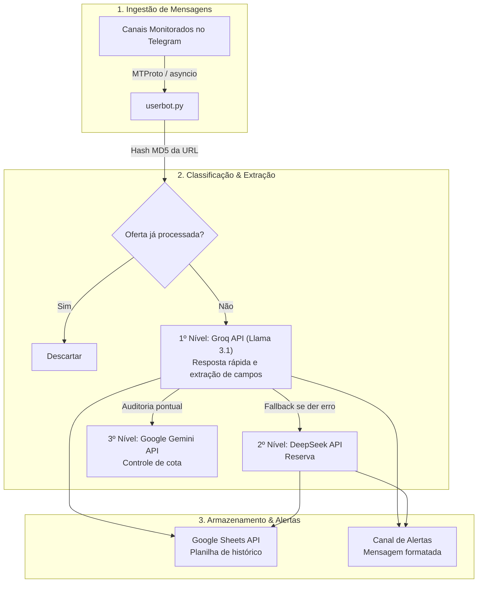

# Bot de Promoções para o Telegram com IA

Monitor assíncrono de canais do Telegram desenvolvido em Python via protocolo MTProto, classificação inteligente de ofertas usando modelos de linguagem (Groq / Llama 3, DeepSeek e Google Gemini) e sincronização automática com planilhas do Google Sheets.

---

## Arquitetura do Sistema



---

## Funcionalidades

- **Monitoramento em Tempo Real com `asyncio` e MTProto:** Conecta-se diretamente aos servidores do Telegram via protocolo oficial MTProto, permitindo monitorar dezenas de canais simultaneamente com consumo mínimo de memória.
- **Hierarquia de Modelos com Fallback:** Utiliza prioritariamente o endpoint de alta velocidade da Groq (Llama 3.1 8B) para extrair nome do produto, preço à vista, parcelamento e cupom, alternando para a API do DeepSeek caso haja oscilação na conexão.
- **Filtro de Duplicatas:** Cria um hash único da URL de cada produto para não postar a mesma promoção repetidas vezes.
- **Envio para Google Sheets:** Salva cada promoção classificada diretamente em uma planilha online através da API `gspread`.
- **Fácil Execução em Nuvem ou Local:** Pode rodar no computador ou em servidores (VPS / Railway) através de variáveis de ambiente (`.env`) e sessão em texto (`StringSession`).

---

## Estrutura de Arquivos

```
bot-promocoes-telegram/
├── userbot.py           # Script principal com a lógica assíncrona e envio para planilha
├── userbot_local.py     # Versão simplificada para testes rápidos no terminal
├── logar.py             # Script interativo para autenticar e gerar a StringSession
├── requirements.txt     # Dependências do projeto (cliente MTProto, gspread, aiohttp)
├── .env.example         # Exemplo de configuração de chaves e variáveis
├── .gitignore           # Evita subir sessões e credenciais locais para o GitHub
└── README.md
```

---

## Como Configurar e Rodar

### 1. Pré-requisitos
* Python 3.10 ou superior instalado
* Chaves da API do Telegram (`api_id` e `api_hash`), que você obtém gratuitamente em [my.telegram.org](https://my.telegram.org)

### 2. Instalação

```bash
git clone https://github.com/VPariz/bot-promocoes-telegram.git
cd bot-promocoes-telegram
python -m venv venv

# Ative o ambiente virtual:
# No Windows:
.\venv\Scripts\activate
# No Linux/Mac:
source venv/bin/activate

pip install -r requirements.txt
```

### 3. Configurar as Chaves de Acesso

Copie o arquivo de exemplo para criar o seu `.env`:
```bash
cp .env.example .env
```

Abra o arquivo `.env` e preencha suas informações:
```ini
TELEGRAM_API_ID=seu_api_id_aqui
TELEGRAM_API_HASH=seu_api_hash_aqui
TELEGRAM_SESSION_STRING=sua_string_session

# Chaves das APIs de IA
GROQ_API_KEY=sua_chave_groq
DEEPSEEK_API_KEY=sua_chave_deepseek
GEMINI_API_KEY=sua_chave_gemini

# Nome da sua planilha no Google Drive
GOOGLE_SHEET_NAME=nome_da_sua_planilha
```

### 4. Gerar a Sessão de Acesso do Telegram

Para o bot conseguir se conectar sem pedir código por SMS toda vez:
```bash
python logar.py
```
O script exibirá uma linha longa de texto (`StringSession`). Copie e cole esse texto na variável `TELEGRAM_SESSION_STRING` dentro do seu `.env`.

### 5. Iniciar o Bot

```bash
python userbot.py
```

---

## Licença
Distribuído sob licença MIT. Consulte o arquivo `LICENSE` para mais detalhes.
