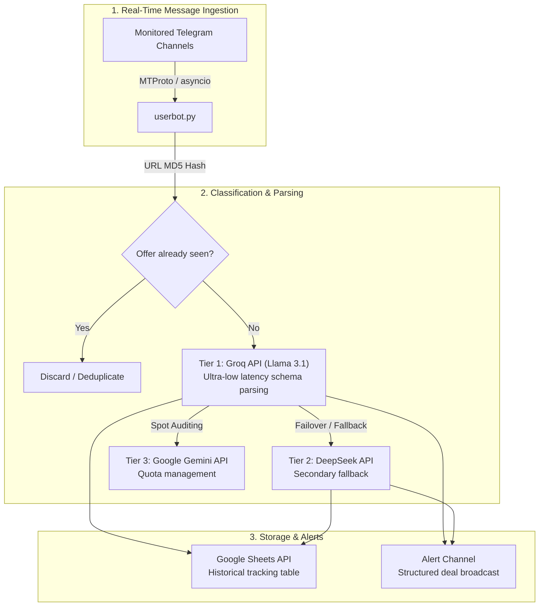

# Telegram Deal Scraper & LLM Classifier

[](https://python.org)
[](https://core.telegram.org/mtproto)
[](https://groq.com)
[](https://developers.google.com/sheets/api)
[](LICENSE)

Asynchronous real-time Telegram channel scraper built with Python (`asyncio` and MTProto), intelligent e-commerce deal classification and extraction using large language models (Groq / Llama 3.1, DeepSeek, and Google Gemini), and automated live sync with Google Sheets.

---

## 🏗️ System Architecture



---

## ⚡ Features

- **Asynchronous MTProto Client:** Interfaces natively with Telegram's MTProto protocol using `telethon` and Python's `asyncio`, monitoring multiple high-volume broadcast channels concurrently with minimal RAM overhead.
- **Hierarchical Multi-LLM Parsing:** Queries Groq's high-throughput Llama 3.1 endpoint to parse product titles, spot cash prices, installment plans, and coupon codes, automatically falling back to DeepSeek if rate limits or network issues arise.
- **Cryptographic Deduplication:** Hashes target checkout URLs (MD5) to prevent redundant database entries and notification spam.
- **Cloud & Headless Execution:** Designed for headless 24/7 cloud deployment (VPS, Railway, Docker) using environment variables (`.env`) and string-serialized Telegram sessions (`StringSession`).

---

## 📂 Repository Structure

```
bot-promocoes-telegram/
├── userbot.py           # Core asynchronous scraper, LLM dispatcher & Google Sheets exporter
├── userbot_local.py     # Lightweight local testing script for quick terminal verification
├── logar.py             # Interactive auth script to generate a headless StringSession
├── requirements.txt     # Python dependencies (Telethon, gspread, aiohttp)
├── .env.example         # Template for API credentials and secrets
├── .gitignore           # Ignores local session tokens and environment files
└── README.md
```

---

## 🚀 Setup & Execution

### 1. Prerequisites
* Python 3.10+
* Telegram API credentials (`api_id` and `api_hash`), obtainable via [my.telegram.org](https://my.telegram.org)

### 2. Installation

```bash
git clone https://github.com/VPariz/bot-promocoes-telegram.git
cd bot-promocoes-telegram
python -m venv venv

# Activate virtual environment:
# On Windows:
.\venv\Scripts\activate
# On Linux/macOS:
source venv/bin/activate

pip install -r requirements.txt
```

### 3. Environment Configuration

Copy the template configuration file:
```bash
cp .env.example .env
```

Edit `.env` with your API credentials:
```ini
TELEGRAM_API_ID=your_api_id_here
TELEGRAM_API_HASH=your_api_hash_here
TELEGRAM_SESSION_STRING=your_string_session

# LLM API Keys
GROQ_API_KEY=your_groq_key
DEEPSEEK_API_KEY=your_deepseek_key
GEMINI_API_KEY=your_gemini_key

# Destination Google Sheet name
GOOGLE_SHEET_NAME=your_sheet_name
```

### 4. Authenticate Telegram Client

Generate an authorization `StringSession`:
```bash
python logar.py
```
Copy the printed session string into the `TELEGRAM_SESSION_STRING` field in `.env`.

### 5. Launch Scraper Daemon

```bash
python userbot.py
```

---

## 📜 License
This project is licensed under the **MIT License** — see the `LICENSE` file for details.
